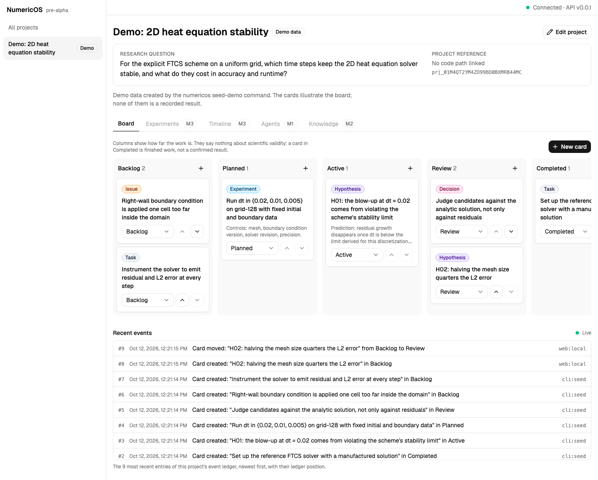
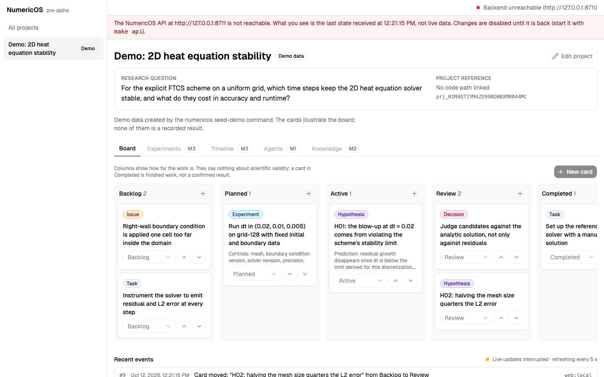
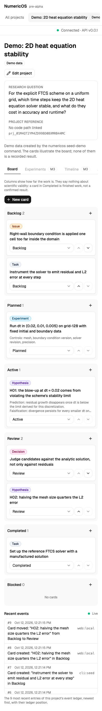

# M0 gate evidence

**Status: accepted on 2026-10-12.** Tickets M0-T01 to M0-T05 are on `main`; the tag `m0-gate`
marks the accepted revision. Nothing in this document claims that a later milestone works.

**Exit gate (from `milestones/M0/AGENTS.md`):** a scientist can create and organize a real
computational project, and an external scripted client sees the same durable state and ordered
events.

## How to check it yourself

```bash
make install            # uv sync + npm ci + Playwright Chromium (first time only)
make api                # terminal 1: migrates ~/.numericos/numericos.db, API on http://127.0.0.1:8765
make web                # terminal 2: GUI on http://localhost:5173
make seed-demo          # optional: one project clearly marked as demo data
```

1. In the GUI create a project, add typed cards, move and edit them.
2. Reload the page: the board and the "Recent events" list are unchanged.
3. Stop `make api` (Ctrl+C): the GUI reports the backend as unreachable, marks what it shows as
   the last known state and disables changes. Start it again: the page recovers by itself.
4. From a third terminal read the same state as a scripted client:

```bash
.venv/bin/numericos project list --json
.venv/bin/numericos card list --project PROJECT_ID
.venv/bin/numericos events list --project PROJECT_ID --json     # ordered ledger
.venv/bin/numericos events follow --project PROJECT_ID          # replay, then live; Ctrl+C stops
```

Automated checks:

```bash
make lint typecheck     # ruff, mypy --strict, eslint, tsc
make test               # pytest + vitest
make e2e                # Playwright against real API processes (own ports and data directories)
make check-contracts    # the committed OpenAPI contract and TypeScript types are current
```

## Results

Run on 2026-10-12, macOS 26.6 (arm64), Python 3.12.9, Node 23.10.0, on a fresh clone of this
revision as well as on the working copy.

| Command | Result |
| --- | --- |
| `make lint` | PASS |
| `make typecheck` | PASS (mypy strict on 71 files, tsc) |
| `make test`, backend | PASS: 152 tests (unit 25, persistence 19, api 72, cli 19, integration 17) |
| `make test`, frontend | PASS: 37 tests in 8 files |
| `make e2e` | PASS: 19 journeys in 7 spec files |
| `make check-contracts` | PASS |

No test uses a mocked backend except the Vitest component tests, which stub `fetch`. Every
pytest and Playwright test runs against a real SQLite database; the CLI, concurrency, stream
and restart tests run against real `numericos serve` processes.

## The exit gate, requirement by requirement

| Requirement | Evidence |
| --- | --- |
| Create and organize a project from the GUI | `e2e/00-first-run.spec.ts`, `e2e/board.spec.ts` (create, move, reorder, edit) |
| State survives a browser reload | `e2e/board.spec.ts` (every journey reloads), `e2e/walkthrough.spec.ts` |
| State survives an API restart | `tests/integration/test_restart_persistence.py`, `e2e/restart.spec.ts` (a real process restarted under an open page) |
| A scripted client sees the same state | `tests/cli/test_cli_data.py`, `e2e/interop.spec.ts` (CLI to browser and browser to CLI) |
| Ordered events can be replayed | `tests/api/test_events.py`, `tests/integration/test_sse.py`, `tests/cli/test_cli_follow.py` |
| No fabricated AI message, metric or result | no such feature exists; the GUI holds no mock data; demo data only by `seed-demo` and labelled |

### Testing contract of the brief (section 6)

| Brief | Test |
| --- | --- |
| Fresh migration, bootstrap, normal startup | `tests/persistence/test_migrations.py` (fresh, idempotent, down/up, `alembic check`, PRAGMAs); `tests/cli/test_cli.py` (startup migrates) |
| Project CRUD, card update and reorder on real SQLite | `tests/api/test_projects.py`, `tests/api/test_cards.py` |
| Rollback: an invalid update produces no event | `tests/persistence/test_unit_of_work.py::test_failure_rolls_back_state_and_event`; stale and invalid requests in `tests/api/test_cards.py` and `test_projects.py` assert an unchanged ledger |
| Two events replayed in sequence after a reconnect | `tests/integration/test_sse.py::test_reconnecting_with_last_event_id_replays_exactly_what_was_missed` |
| Unknown IDs and wrong project membership give 404/409 | `test_unknown_card_is_404`, `test_project_assertion_must_match`, `test_unknown_project_is_a_typed_404` |
| Frontend create, move, update, reload against the real API | `e2e/board.spec.ts` |
| Empty and API-down states | `e2e/00-first-run.spec.ts`, `e2e/connection.spec.ts`, `src/pages/ProjectsPage.test.tsx` |
| Accessibility basics | `e2e/board.spec.ts::the board is usable from the keyboard`; labelled controls throughout (tests locate elements by role and label) |
| CLI `--json` parseable, diagnostics on stderr, exit codes | `tests/cli/test_cli.py`, `test_cli_data.py`, `test_cli_follow.py` |
| CLI-created project in the browser and the reverse | `e2e/interop.spec.ts`, `e2e/00-first-run.spec.ts` |

### Event ledger reliability (section 5)

| Brief | Evidence |
| --- | --- |
| Mutation and event in the same transaction; publish only after success | `test_commit_persists_state_and_event_together`, `test_publish_happens_only_after_a_durable_commit` (a second connection already sees the row when `publish` runs) |
| Ordering by a monotonic sequence, not by timestamps | `events.seq` is `AUTOINCREMENT`; `test_events_are_returned_in_sequence_order`; 20 concurrent writers in `tests/integration/test_concurrency.py` |
| Reconnect emits missed events once, by cursor | `tests/integration/test_sse.py` (`Last-Event-ID`, `after`, both combined) |
| Clients de-duplicate by event ID | `src/api/useEventStream.test.tsx::re-reads the project once for every new event` |
| Refresh keeps the board; restart keeps DB and events | `e2e/board.spec.ts`, `tests/integration/test_restart_persistence.py`, `e2e/restart.spec.ts` |
| No polling loop that fabricates progress | polling only re-reads real state, and only where no live stream exists |
| Correlation IDs on every event | `test_actor_defaults_and_correlation_id_is_kept`; the header is echoed on every response |

Beyond the brief: a commit that lands during a ledger read is not lost
(`tests/unit/test_stream.py`), events committed by another process reach subscribers within one
heartbeat, a cursor beyond the ledger head is refused instead of silently starving, and a server
with open subscribers stops promptly (`tests/integration/test_sse.py`).

## Event IDs, cursors and reconnect behaviour

Captured on 2026-10-12 from `numericos serve` on a throwaway data directory (lines shortened).
A first client reads the two existing events and goes away:

```text
$ curl -N -H "Accept: text/event-stream" "$URL/v1/events?project_id=$PID"
retry: 2000
id: 1
data: {"event_id":"evt_01M4QT1Y39WZ90KTVXM6GB60PC","seq":1,...,"type":"PROJECT_CREATED",...}
id: 2
data: {"event_id":"evt_01M4QT1YE2ZN4WG9DCDR0M7YJS","seq":2,...,"type":"CARD_CREATED",...}
```

Two more changes are committed. The client reconnects with the ID of the last event it saw and
receives exactly the two it missed, in order:

```text
$ curl -N -H "Accept: text/event-stream" -H "Last-Event-ID: 2" "$URL/v1/events?project_id=$PID"
retry: 2000
id: 3
data: {"event_id":"evt_01M4QT1ZRZ05FB9MA1Y9YQT1H1","seq":3,...,"type":"CARD_MOVED",...}
id: 4
data: {"event_id":"evt_01M4QT203BYP66YMXHH654PCAQ","seq":4,...,"type":"CARD_CREATED",...}
```

The JSON page of the same ledger lists the same four events with the same IDs and cursors:

```text
1 PROJECT_CREATED cli:local evt_01M4QT1Y39WZ90KTVXM6GB60PC
2 CARD_CREATED    cli:local evt_01M4QT1YE2ZN4WG9DCDR0M7YJS
3 CARD_MOVED      cli:local evt_01M4QT1ZRZ05FB9MA1Y9YQT1H1
4 CARD_CREATED    cli:local evt_01M4QT203BYP66YMXHH654PCAQ
next_cursor 4 | has_more False
```

In the same session `numericos serve --reload` (what `make api` runs) restarted in about one
second while a subscriber was connected, and the ledger was unchanged afterwards.

## GUI walkthrough

Produced by `e2e/walkthrough.spec.ts` on the real GUI and a real API. The data is the project
created by `numericos seed-demo`, labelled "Demo data" in the GUI; the cards illustrate the
board and none is a recorded result. The spec creates a hypothesis card in the dialog, moves it
from Backlog to Review, reloads the page and asserts that the board and the event list are
identical before taking the first screenshot.

After create, move and reload. The two newest entries of "Recent events" are the creation and
the move made in the GUI (`web:local`); the older ones were written by the seed command
(`cli:seed`). Views of later milestones are disabled and name their milestone.



Backend unreachable: the state shown is marked as the last one received, every control that
changes data is disabled and the page no longer claims live updates.



Narrow width: columns stack, card text wraps and is never cut off.



## Where the contracts are documented

- Schema, public API, error codes, event envelope and stream, CLI, GUI behaviour:
  `docs/architecture.md`.
- Machine-readable contract: `contracts/openapi.v1.json` (also served at `/v1/openapi.json`,
  interactive at `/v1/docs`).
- Decisions: `docs/adr/0001` (one Python distribution), `0002` (transactional ledger),
  `0003` (event stream).

## Deviations from the brief

| Brief or plan | What was done, and why |
| --- | --- |
| Suggested layout `apps/api` + `packages/*` | One distribution `src/numericos/` with the same boundaries as subpackages (ADR-0001); the brief allows it when recorded |
| "One coherent reviewable commit" | One commit per ticket (T01 to T05), each verified before the next started |
| Connection indicator shows the transport | The global indicator shows backend reachability; "Live" or "Live updates interrupted" is shown with the event list, the part of the page it describes |
| Browser reconnects with `Last-Event-ID` | The server implements and tests it; the GUI instead re-reads the ledger head and subscribes after it on every (re)connection, so a stale cursor is never reused (ADR-0003) |
| Polling fallback acceptable | The project list is polled every 5 s; project pages poll only while their stream is not live |

## Known limitations

Listed in `docs/architecture.md` ("Known limitations"). In short: single user and single
API process on loopback, no idempotency keys, no delete or archive, `root_path` stored but never
opened, project list polled, event list limited to the 20 newest entries, no drag and drop
before M1, schema migrations need a manual restart of a `--reload` server.

Outside the code:

- The GitHub Actions workflow exists on the local branch `ci/github-actions-workflow` and is not
  on GitHub yet, because the token used for pushing lacks the `workflow` scope. Until it is
  pushed, the checks above run only locally.
- The public repository has no `LICENSE` file.

## Not built in M0, by design

No coding agent or chat, no text anchoring, no knowledge or context compilation, no skill
loading, no numerical execution, no job supervision, no validators. `AgentAdapter` and
`SkillRegistry` exist only as documents. These belong to M1 and later.

## Sign-off

- [x] 2026-10-12: after using the GUI on their own data the project owner instructed to proceed
      with development, with further board work as the last priority.
- [x] Tag `m0-gate` created on the revision described here (`882aac3`).
- [x] `CURRENT_MILESTONE.md` updated. It points to M3 rather than M1: the owner put the
      observability of code and experiments first (ADR-0004).
